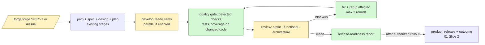

# forge — adaptive automated SDLC + quality (prompt 03) — proposal

Status: design · ✅ approved 2026-11-18 · next: Phase 1 plan (`docs/2026-11-18-forge-adaptive-sdlc-phase1-plan.md`)
Inputs: `00-shared-mandate.md` (governing), `03` (revised), forge 0.3.0 (prompts 01 + 02 slices). Extends existing stages, rules, ledger — no parallel SDLC.

## 1. Gap analysis (forge 0.3.0)

| Need (03) | Today | State |
|---|---|---|
| One entrypoint from spec/issue; forge picks process; resume; overrides | `/forge:forge` infers next step (§5); `design <SPEC>` / `develop <item\|#issue\|batch>`; resume from docs | ✅ mostly — no "run to release-ready" mode, no `until`/`only` overrides |
| Combine approvals where safe + authorized | approval points per path (G1) | partial — no project-level authorization to combine |
| Execute ready work, parallel where safe | `develop batch` runs sequentially; `plan` gives batches | partial — no isolated parallel execution |
| Language / DB guardrails, profiles | `rules/code-standards.md` (generic CS1–CS11), `test-standards`, `security-checklist`, `api-standards` | partial — no JS/TS, Java, Python, DB profiles |
| Detect existing CI + checks; propose minimal config; run them | ai-readiness lists feedback loops (advisory) | missing — no detection → commands, no gate |
| Coverage baseline + changed-code target | none | missing |
| Three review perspectives; independent for high risk; findings with evidence | `review code` = one checklist; independent reviewer only on ask (G9) | partial |
| Fix findings + rerun, bounded | none | missing |
| Implemented ≠ reviewed ≠ verified ≠ released | spec status implemented / verified / released; review verdict separate | partial — no single readiness view |
| Release-readiness summary → Forge Product | none (01 Slice 2 `release` / `outcome` not built) | missing |
| Metrics: time to slice, interventions, rework, escaped defects | index `Started` / `First slice` / `Released` | partial |
| Demos + overhead vs existing forge | evals harness exists (D1, D3, E1–E3) | reuse |

Local tooling (this machine, 2026-11-18): node 24 + npm/npx, java, sqlite3, python3 3.9; **no** tsc, eslint, prettier, ruff, mypy, pytest, coverage, mvn, gradle. Demos must work with what's present and report the rest as unrun (mandate).

## 2. Flow


**Read:**
- One command takes a spec or issue through the existing stages; forge picks the path and stops only at approval points.
- After code, a quality gate runs the project's own checks (detected, not assumed), then three review perspectives look at it.
- Blocking findings loop back into a fix-and-rerun cycle, capped at 3 rounds; then a readiness report says exactly what is implemented, reviewed, verified — and what is not.
- Release and business outcome stay with the product stages after an authorized rollout; forge never deploys or merges on its own.

## 3. Entrypoint + overrides (`SKILL.md` §3, §5)

| Command | Does |
|---|---|
| `/forge:forge SPEC-7` · `#123` | continue from current state, through non-approval steps, stopping at approval points / blockers (same as today's §5; decided 2026-11-18) |
| `… until <step>` | stop after step (`design`, `plan`, `develop`, `review`) |
| `… only <step>` | run one step (= today's `<step>` override) |
| `/forge:forge` | resume next step (unchanged) |
| `/forge:forge status` | one line per open task: path, step, readiness |

Project authority (project `CLAUDE.md`, all optional, default = ask):

```
forge-approvals: combined      # standard path: one approval for spec+design when spec is approved by product already
forge-review: independent      # deep path: fresh-context reviewer per perspective (relaxes G9 for review only)
forge-parallel: worktrees      # run independent batch items in isolated git worktrees (relaxes G9 for develop only)
```
G1 approval points never drop below one per path; external/irreversible actions always ask (G1, TR2).

## 4. Engineering foundation — profiles (`rules/quality.md` + `rules/profiles/`)

`rules/quality.md` (QG1…): gate definition, evidence format, coverage rule, unrun-check reporting, don't weaken gates, no legacy cleanup (G8), versions chosen from the project runtime + official docs at implementation time (never hardcoded in forge).

| Profile | Loaded when | Covers (defaults, project tools win) |
|---|---|---|
| `profiles/js-ts.md` | `package.json` / `tsconfig.json` | ESLint, `tsc --noEmit`, Prettier check, Jest/Vitest/framework tests, Playwright when browser flows; async errors, boundary validation, `unknown` over `any`, contract types |
| `profiles/java.md` | `pom.xml` / `build.gradle*` | existing Maven/Gradle tasks, Checkstyle/Spotless, SpotBugs/PMD, JUnit, Testcontainers, JaCoCo; resources, concurrency, nullability, transactions |
| `profiles/python.md` | `pyproject.toml` / `requirements*.txt` / `*.py` | Ruff (or existing), mypy/pyright, pytest + coverage; exceptions, typing, async/resource handling, venv isolation |
| `profiles/database.md` | migrations dir / ORM / `*.sql` | migration validation, compat (expand/contract), constraints, transactions, index/query review, rollback/forward recovery; destructive DDL needs approval (G6) |

Only the matching profiles load (progressive).

`scripts/quality_detect.py <repo>` (stdlib, tested): reads manifests, lockfiles, CI config (`.github/workflows`, `.gitlab-ci.yml`, `Jenkinsfile`), configs (`.eslintrc*`, `eslint.config.*`, `ruff.toml`, `[tool.ruff]`, `checkstyle.xml`…) → JSON: languages, profiles, checks `{name, command, source: script|ci|config|default, available: yes|no|unknown}`. Prefers commands the project already defines (`npm run lint`, `make test`, CI steps). Absent tool → `available: no` + suggested minimal config — proposed, never installed without approval.

## 5. Quality gate (extends `stages/test.md`)

1. `quality_detect.py` → check list (cached in ledger header; re-detect if manifests change).
2. Run **relevant** checks: changed-language lint/type/format, affected tests; broader regression on deep path or shared-module changes.
3. Coverage: baseline from base commit when the project has coverage tooling; changed-code coverage via `scripts/changed_coverage.py` (lcov / Cobertura XML + `git diff`). Target from project policy, else default 80% changed lines (configurable `forge-coverage: <n>`); below → finding, not auto-fail of legacy.
4. Evidence in ledger: `command → exit code, counts` per check. Unrun → `not run: <reason>` (tool missing, no CI access) — never omitted, never claimed.

## 6. Review — three perspectives (extends `stages/review.md`)

| Perspective | Checks | Evidence |
|---|---|---|
| 1 static | lint/type/format/security/dependency output, idioms, `rules/code-standards.md`, profile items | tool output first; reasoning only where tools are silent |
| 2 functional | every spec AC has a passing test; authz + tenant boundaries; edge cases; regressions; user journey | spec, tests, ledger |
| 3 architecture | contracts, modularity, reliability, failure handling, performance, data integrity, rollout, evolution path vs design | design, code, `rules/api-standards.md`, `rules/security-checklist.md` |

Finding row: `| ID | Perspective | Severity | Where | Evidence | Ref (R/AC/§) | Impact | Fix | Verify |`. Severity critical / high = blocker; medium = fix or accept with reason; low = optional.
Path: fast → one combined pass; standard → combined, sections per perspective; deep → separate passes, independent contexts when `forge-review: independent`.

**Remediation:** blockers → fix (smallest change, G8) → rerun affected checks + tests → re-review those findings (append-only). Max 3 rounds (configurable); still failing → `⛔ blocked` with evidence, ask user. Fix that changes design/scope → stop, reopen approval (CT8).

## 7. Release readiness (`templates/readiness.md`, written at end of review)

| State | Meaning | Source |
|---|---|---|
| implemented | all items ✅ with `Verified by` | ledger |
| reviewed | review verdict approve, no open blockers | review file |
| verified | every AC has passing test evidence | spec status `verified` |
| release-ready | above + rollout/rollback, flags, migrations, observability checked | readiness report |
| released | after authorized rollout (01 Slice 2) | product |

Report: per-AC evidence, checks run / not run, coverage, open findings, remaining risks, rollout + rollback notes, recommended next action. Never says merged/deployed/released without evidence.

## 8. Metrics (mandate)

Observed only: `Started`, `First slice`, `Released` (index, exists); ledger Log tags `[approval]`, `[intervention]` (user had to unblock/correct), `[rework]` (item reopened / review round); escaped defect = later spec with `fixes: SPEC-n` (optional front matter). Readiness report prints counts + elapsed; friction notes → `evals/` suggestions, never a silent rule change.

## 9. Phases

| Phase | Ships | Acceptance |
|---|---|---|
| 1 | entry `SPEC/#issue` + `until`/`only`/`status`; `rules/quality.md`; 4 profiles; `quality_detect.py` + tests; quality gate in test stage; 3-perspective review (combined) + remediation loop; readiness template; metrics tags; `fixes:` field; `forge-approvals: combined` | tests green; demos Q1–Q7 + overhead vs 0.3.0 |
| 2 | `changed_coverage.py` + tests; `forge-review: independent` (deep path, 3 fresh reviewer contexts); product `prd` (baseline) + `release` stages (01 Slice 2) consuming readiness | demos Q8, Q10, PRD baseline demo |
| 3 | product `outcome` stage (needs real post-rollout data) | outcome demo |
| deferred | `forge-parallel: worktrees` (until a real plan has ≥ 3 parallel items); tracker live publish demo (02) | — |

## 10. Demos (headless, fixtures; overhead vs forge 0.3.0 = turns, questions, secs, docs)

| # | Case | Pass when |
|---|---|---|
| Q1 | fast UI fix (TS fixture) | fast path; one item; detected checks run or reported unrun; one combined review; readiness report |
| Q2 | regular feature (projapp SPEC-1 to release-ready) | full run from one command; 3-perspective review; readiness distinguishes implemented / reviewed / verified |
| Q3 | failing quality check (planted lint/test failure) | finding → fix → rerun → pass, within 3 rounds; evidence recorded |
| Q4 | unsupported tooling (no ruff/pytest/eslint here) | checks listed as `not run: tool missing` + minimal proposal; nothing installed; not claimed |
| Q5 | approval denial | denial logged `[approval]`, work stops, alternatives offered, nothing built |
| Q6 | interruption + resume | kill mid-develop → new session resumes from ledger, no completed item redone |
| Q7 | uncertain integration | spike item with question + time box → decision → plan |
| Q8 | high-risk migration (deep) | expand/contract, rollback validated, destructive step needs approval, independent review |
| Q9 | parallel batch | independent items in worktrees, integrated without conflict |
| Q10 | product spec → release-ready → product hand-off | full slice across 01–03 |

## 11. Breaking-change risks

| Change | Risk | Mitigation |
|---|---|---|
| Run-to-ready default for `SPEC/#issue` | more autonomy | approval points unchanged; `until` override |
| Review format (perspective column) | old review files | append-only; old files stay valid |
| G9 relax via config | subagents spend tokens | opt-in per project; deep only for review |
| New gate in test stage | slower fast path | relevant checks only; fast path = changed files |

## 12. Decisions (2026-11-18)

- D1 Entry keeps today's behaviour: continue through non-approval steps, stop at approval points (option a).
- D2 Demo fixtures may install eslint/tsc **inside the fixture** (npm, network); a separate tool-less fixture proves Q4.
- D3 Independent review (subagents, deep path, opt-in) in Phase 2; parallel worktrees deferred (Q7 spike demo in Phase 1 — no subagents; Q9 deferred).
- D4 Product `prd` + `release` in Phase 2; `outcome` in Phase 3.
