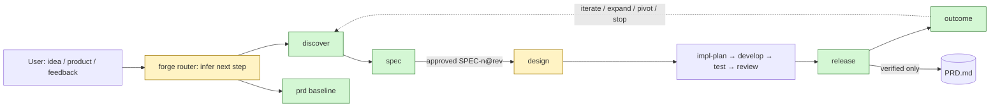
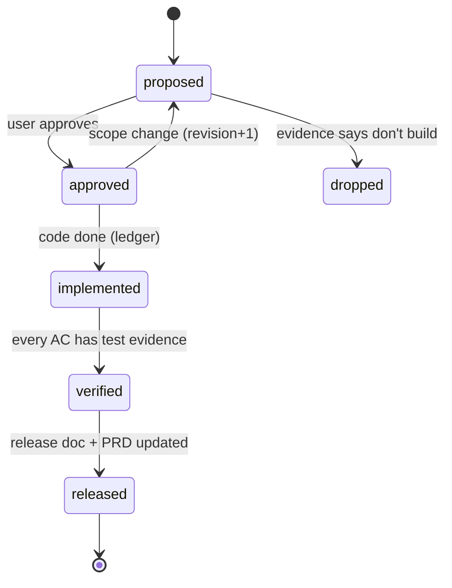
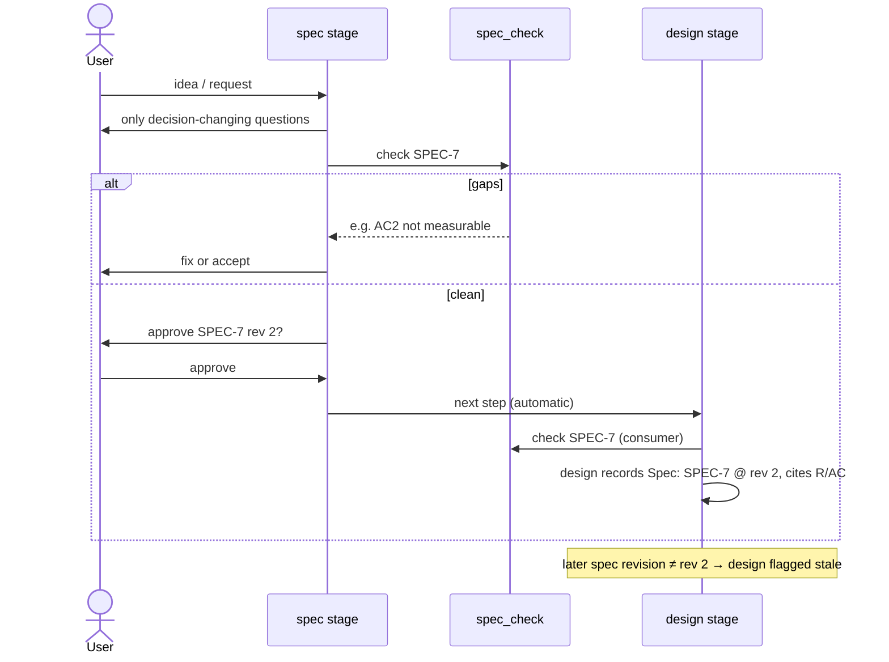

# forge — product stages (idea → validated outcome) — proposal

Status: design · ✅ v3 approved · 2026-11-18 · next: Slice 1 plan (`docs/2026-11-18-forge-product-slice1-plan.md`)
Inputs: `Forge_Leadly_8_Prompts/` revised `00-shared-mandate.md` (governing) + `01` (this) · coordinates with `02` (spec → design → issues), `03` (orchestration, quality).
Supersedes v2 (separate `forge-product` plugin; backup kept outside repo). Decided 2026-11-18: product capabilities live **inside `forge`**.

## 1. Gap analysis (forge 0.1.2, HEAD `9447a7f`)

| Need (00 / 01) | Today | State |
|---|---|---|
| One entrypoint that infers next action | `SKILL.md` §3 no-args → resume/list; asks which task, then which stage | partial |
| Adaptive path fast / standard / deep | Fix / Change / Build sizing | partial (rename + rules) |
| Ask only consequential questions | §6 grills every stage, one Q per message | partial — too many by default |
| Approvals scaled by risk | G1: approval before every stage output | missing — G1 uniform |
| Discovery, market, MVP recommendation | none (design stage starts from a task) | missing |
| Spec with stable IDs + validation | design doc, `R#`/`UC#` local to file, no front matter, no validator | partial |
| Living master PRD (released only) | `understanding.md` = code view; no product/released view | missing |
| Handoff to engineering, no restating | design stage itself writes Problem → Use cases | partial (merge point) |
| Release positioning / briefs, outcome review | none | missing |
| Traceability req → design → test → release | `R#` → impl step → ledger `Verified by` | partial (no release/outcome) |
| Product review | `review` types design/arch/test/code | partial (add `spec`) |
| Reuse: rules, ledger, index, reviews, diagrams, check.sh | all exist | reuse as-is |

## 2. What changes — summary


**Read:**
- Same `/forge:forge` entrypoint; the router now works out the next step and runs it, asking only at approval points.
- Five new stage files (green): discover, spec, prd, release, outcome. Engineering stages unchanged except design links the spec instead of restating it.
- PRD changes only when a release is verified; outcome feeds the next decision.
- Product-only use: stop after discover, spec, prd or outcome — engineering never required.

## 3. Paths (replace Fix / Change / Build; old names accepted as aliases)

| Path | When | Product steps | Engineering steps | Approvals (G1 scaled) |
|---|---|---|---|---|
| fast | clear, reversible, low-risk | one concise spec = design lite | develop → test → review code | 1: scope + fix |
| standard | feature | discover (lite, skip if clear) → spec | design → impl-plan → develop → test → review | spec, design/plan |
| deep | high uncertainty, irreversible migration, security / cross-system | discover (+ research, optional time-boxed spike) → spec | design → architect → review → impl-plan → develop → test → review → staged rollout | spec, design, rollout |

- Router proposes path from evidence; escalates/simplifies mid-way with one-line reason.
- Time aims (not promises): fast hours; standard usable MVP in 2–3 days, production-ready ≤ 2 weeks when scoped so. Can't fit → cut scope or report blocker; quality never skipped.
- Spike = question + time box + resulting decision; never default.

## 4. Router: own the process

No-args or any free-text request:
1. Read index + active task's spec/design `Status:` + ledger `Next:` (docs, not chat memory).
2. Decide next step; print one line: `SPEC-7 Lead dedupe · standard · spec approved → next: design (starting)`.
3. Run it. Stop only for: approval point (§3), consequential ambiguity, irreversible action, missing authority.
4. Several open tasks → one line each, user picks.

Questions rule (replaces "grill every row"): ask only if answer changes the decision; batch related questions; otherwise state assumption `(assumption)` and continue. Experts can name stage/path explicitly to override.

SKILL.md stays < 150 lines (now 89): routing table + path table + next-step rule; detail in stage files.

## 5. Contract (`rules/contract.md`, version `contract: 1`)

Inside forge → one copy, no cross-plugin sync.

### 5.1 IDs

| ID | Example | Where |
|---|---|---|
| Spec = initiative | `SPEC-7` (= task folder `07_<slug>`) | spec front matter |
| Requirement | `SPEC-7.R3` | spec |
| Acceptance criterion | `SPEC-7.AC2` (cites R3) | spec |
| Work item | `SPEC-7.TASK2` (= impl step 02; tracker id added by 02) | ledger |
| Feature (released behavior) | `FEAT-4` | `PRD.md` |

Numbers plain, never reused. Design decisions, tests: referenced by doc § / `path::test name` — no new ID kinds unless 02/03 need them.

### 5.2 Spec file `tasks/07_<slug>/YYYY-MM-DD_<slug>_spec.md`

Front matter (required):
```yaml
---
contract: 1
id: SPEC-7
revision: 2
status: approved        # proposed | approved | implemented | verified | released | dropped
source_rev: 9447a7f     # repo commit the spec was written against
depends_on: [SPEC-3]    # optional
changes: [FEAT-4]       # optional: released features this modifies
---
```

| Section | fast | standard | deep |
|---|---|---|---|
| Objective (+ success / failure criteria) | ✓ | ✓ | ✓ |
| Scope + Non-goals | ✓ | ✓ | ✓ |
| Requirements `R` | ✓ | ✓ | ✓ |
| Acceptance criteria `AC` (measurable, cites R) | ✓ | ✓ | ✓ |
| Constraints + Dependencies | if any | ✓ | ✓ |
| Persona · job · value · journeys · business rules | — | ✓ | ✓ |
| KPIs (baseline, target, how measured) + telemetry events | — | ✓ | ✓ |
| Now / next / later + MVP slice | — | ✓ | ✓ |
| Evidence & assumptions (dated sources, quantified assumptions) | — | if any | ✓ |
| Rollout / rollback | — | if risky | ✓ |
| Clarifications · Changes (dated) | as needed | as needed | as needed |

Rules:
- Link, don't copy: spec cites `FEAT-*` and research files; design cites `SPEC-7.R*`; PRD cites specs on release.
- Numbers: units + assumption + how to measure; unknown → `(assumption)` or `not measured`, never invented.
- Approved scope change → `revision`+1, status `proposed`, `## Changes` line, re-approve. Clarification without scope change → `## Clarifications` line.

### 5.3 Status


**Read:**
- User approves a spec; engineering marks it implemented, then verified once every acceptance criterion has test evidence.
- Only a release makes it released — and only then does the PRD change.
- "Don't build" is a first-class outcome (`dropped`), with the reason recorded.

### 5.4 Validator `skills/forge/scripts/spec_check.py` (python3 stdlib)

| Command | Does | Run by |
|---|---|---|
| `check <spec>` | front matter, required sections per path, R↔AC links, ID format, status rules | spec stage before approval; design stage before start (handoff) |
| `check --prd` | PRD lists only `released` specs/features | release stage |
| `trace [root]` | R → design § → TASK → test evidence → release → outcome; prints gaps | review, release |
| `--json` | same output machine-readable (optional manifest for 02/03 automation) | 02 / 03 |

Compatibility: missing `contract:` = legacy doc → skipped with notice (existing tasks never break). Newer minor fields ignored. Breaking contract change → `contract: 2` + migration note in CHANGELOG.

### 5.5 Ownership

| Product (forge product stages) | Engineering (forge eng stages, 02, 03) | Tracker |
|---|---|---|
| intent, spec, AC, KPIs, released capability (PRD), release decision | design decisions, plan, code, test evidence | live issue status |

### 5.6 Handoff (sequence)


**Read:**
- The spec is validated before the user is asked to approve; problems come back as a short fix list.
- Approval hands straight to design — no command needed — and design re-validates before starting.
- Design pins the spec revision; if product later changes the spec, design is flagged stale instead of silently drifting.

## 6. New / changed files

| File | Change |
|---|---|
| `SKILL.md` | paths, next-step inference, question rule, route new stages |
| `rules/guardrails.md` | **G1 scaled by path** (§3 approvals) — governance change, needs approval |
| `rules/contract.md` | new — §5 |
| `stages/discover.md` | new — user/problem/product, code + evidence check, market only when useful (dated sources, hypotheses labelled, cheap experiments first), recommendation: persona, job, value, MVP, success/failure, non-goals, build / test-first / don't-build |
| `stages/spec.md` | new — write spec §5.2, prioritize now/next/later, MVP 2–3 day slice + 2-week path, validate, approve |
| `stages/prd.md` | new — existing product → baseline `PRD.md` (verified released behavior, `FEAT-*`, evidence level per feature, `source_rev`); proposes baseline tag, user runs (G2) |
| `stages/release.md` | new — release doc `releases/vX.Y.Z.md`, PRD update after verified only, briefs on request: positioning, onboarding, landing page, marketing/video scripts (Markdown in repo); media only to user-designated storage, permissions untouched, asset table; no rendering claims without a tool |
| `stages/outcome.md` | new — observed KPIs vs targets, feedback (privacy-aware), recommend iterate / expand / pivot / stop |
| `stages/design.md` | if spec exists: Problem → Use cases = `Spec: SPEC-n @ rev` link + validator run (02 extends) |
| `stages/review.md` | add type `spec`: evidence real, MVP smallest, AC/KPIs measurable, non-goals explicit, no invented numbers |
| `templates/spec.md`, `prd.md`, `release.md` | new |
| `templates/tasks-index.md` | column `Size` → `Path`; add `Started`, `First slice`, `Released` dates (mandate metrics, observed only) |
| docs layout | `<root>/PRD.md`, `<root>/releases/`, `<root>/research/` (only when used). `understanding.md` stays code view, links PRD for behavior |
| `scripts/check.sh` | expected files + run validator fixture tests |

No new plugin, agent, or sync mechanism.

## 7. Phases (smallest usable slice first)

| Slice | Ships | Acceptance |
|---|---|---|
| 1 | contract, validator + fixtures, spec template, `discover` + `spec` stages, router paths + next-step, G1 scaling, design-stage spec link, review `spec` | validator tests green; `check.sh` PASS; demos D1 + D3 pass; design starts from approved spec without restating |
| 2 | `prd`, `release`, `outcome` stages + templates, `trace` | demo D2 passes; PRD unchanged until verified release |
| 3 | tune from measured overhead (§8); `--json` manifest for 02/03 | overhead reduced vs slice-1 run; 02 consumes `--json` |

## 8. Acceptance demos (fictional domains; Leadly only as independent consumer, no Leadly logic in forge)

| # | Case | Pass when |
|---|---|---|
| D1 | Solo founder idea → MVP (e.g. tutoring booking) | ≤ 5 questions; 1 spec; MVP slice ≤ 3 days with success/failure criteria + how measured; no invented market numbers; hands to design |
| D2 | Enterprise existing product enhancement (fixture repo) | baseline PRD with evidence levels; spec `changes: [FEAT-n]`; validator clean on both sides; PRD untouched until verified |
| D3 | Evidence says don't build | spec `dropped` with reason + cheaper experiment; no design started |

Measured per demo (observed, recorded in `docs/plans/` results): questions asked, documents created, human interventions, elapsed minutes. Baseline = same request through current forge (design stage). Target: fewer questions and documents than baseline at equal or better spec completeness.

## 9. Breaking-change risks

| Change | Risk | Mitigation |
|---|---|---|
| Fix/Change/Build → fast/standard/deep | existing `tasks/index.md` rows | aliases; old values read as new |
| G1 scaled approvals | fewer stops = more autonomy | approvals kept at spec, design, rollout, irreversible ops; G2–G9 unchanged |
| Fewer questions | wrong assumptions | assumptions marked + shown at approval |
| Design stage defers to spec | overlap with 02 | rule is only "link if spec exists"; 02 owns the rest |
| Front matter on new docs | legacy docs | validator skips docs without `contract:` |

## 10. Decisions (2026-11-18)

- D-OQ1 G1 scaled by path (§3) — approved.
- D-OQ2 Spec ID = task number (`SPEC-7` ↔ `07_<slug>`) — approved.
- D-OQ3 D2 on fictional fixture repo in `evals/` — approved (Leadly stays independent).
