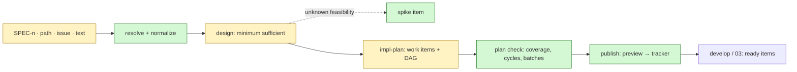
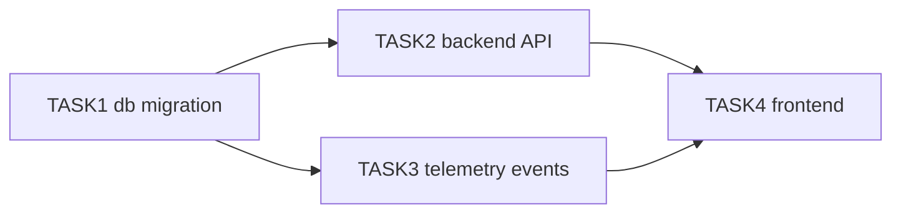
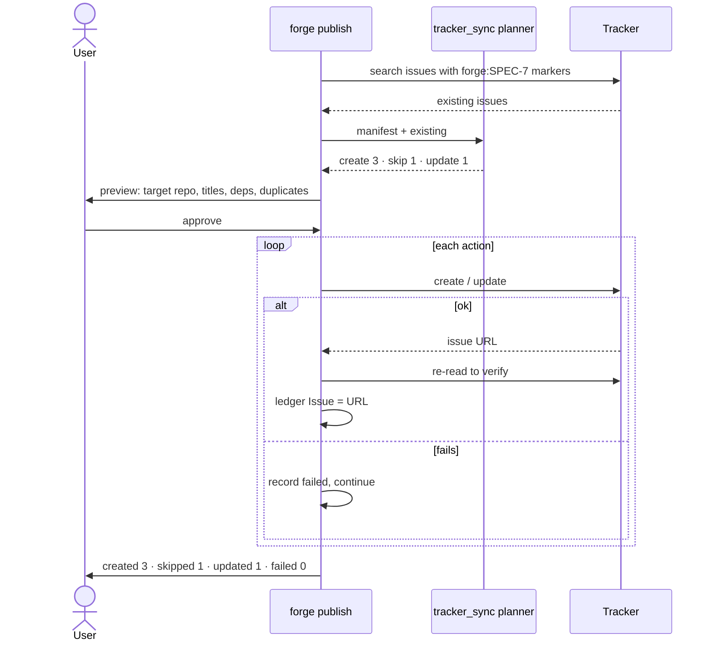

# forge — spec to executable work (prompt 02) — proposal

Status: design · ✅ approved 2026-11-18 · next: Slice A plan (`docs/2026-11-18-forge-spec-to-work-sliceA-plan.md`)
Inputs: `00-shared-mandate.md` (governing), `02-forge-spec-to-issues` (revised), contract from 01 (`rules/contract.md`, forge 0.2.1). Hands off to 03 (execution).

## 1. Gap analysis (forge 0.2.1)

| Need (02) | Today | State |
|---|---|---|
| Entry by spec ID / path / issue / supplied requirement | `design` reads active task's spec; no entry by ID, issue or free text | partial |
| External specs | not supported (validator skips non-contract docs) | missing |
| No second requirements doc; surface gaps | design links spec (`Spec: SPEC-n @ rev N`); gap reporting ad hoc | partial |
| Auto path + targeted spike | paths fast/standard/deep exist; spike mentioned only | partial |
| Minimum sufficient design incl. evolution path + scaling triggers, capacity/cost | design + architect sections; no evolution path / triggers / capacity | partial |
| Work items: stable ID, type, outcome, refs, scope, AC, verify, blockers | impl step file: design ref, files, steps, code, verify; IDs `SPEC-n.TASKn` defined (CT1) but unused | partial |
| Dependencies, cycles, coverage, critical path, parallel batches | `Depends on:` free text; R# coverage checked by hand | missing |
| Tracker publish, preview, idempotent resume, mapping | none | missing |
| Revised spec → impact on plan/issues | stale-design detection (`--rev`) only | partial |
| Handoff to 03 by item / issue / batch | develop runs ledger `Next:` in order | partial |
| Tests | validator tests for specs only | partial |

Reuse unchanged: router, paths, approval points, spec contract, ledger as the one execution record, review stage, `check.sh`.

## 2. Flow


**Read:**
- Any input becomes one contract spec (external ones normalized, gaps listed); engineering never writes a second requirements doc.
- Design writes only what this change needs; a spike runs only when a feasibility question blocks a decision.
- The plan is machine-checked (coverage, cycles, critical path, parallel batches) before anything is published.
- Publishing previews first, is idempotent, and records issue links in the existing ledger; execution (prompt 03) picks up ready items.

## 3. Entry + resolution (`SKILL.md` route + `stages/design.md` §Resolve)

| Input | Resolves to |
|---|---|
| `SPEC-7` / spec path | contract spec; `spec_check.py check --require-approved` |
| Issue `#123` / URL | read via tracker adapter; contains `forge:SPEC-7.TASK2` marker → that item; else treat as external requirement |
| External PRD / doc path | **normalize**: new task + spec with `source: external:<path>@<rev>`, mapped sections, unmapped text kept under `## Imported`, gaps → `## Open gaps`; status `proposed` → spec approval point |
| Supplied text | fast-path spec stub (Objective, Scope, Non-goals, R, AC) → approval |

Contract change (additive, `contract: 1` stays): optional front-matter `source`. Validator `gaps` mode lists missing/weak sections instead of failing (for normalization).

## 4. Design — minimum sufficient (`stages/design.md`, `stages/architect.md`, `templates/design.md`)

Section set chosen by path + relevance; empty sections omitted, never padded.

| Section | fast | standard | deep |
|---|---|---|---|
| Spec link + gaps & proposed decisions | spec `## Fix` | ✓ | ✓ |
| Current vs proposed behavior (`file:line` evidence) | in `## Fix` | ✓ | ✓ |
| Affected components + reuse | — | ✓ | ✓ |
| Alternatives + chosen trade-off | — | if real choice | ✓ |
| Before/after code or API example | ✓ | where helpful | ✓ |
| Data model · permissions · failure modes · compatibility · observability | — | if touched | ✓ |
| Migration + rollback | — | if data/contract changes | ✓ |
| **Evolution path**: now vs later, scaling triggers (metric + threshold), capacity/cost (assumptions labelled) | — | short | ✓ |

Spike: work item type `spike` with question, time box, decision it unblocks; design waits only on spikes marked blocking.

## 5. Work items + plan check (`stages/impl-plan.md`, `templates/impl-task.md`, `templates/ledger.md`)

Item file `impl-tasks/NN_<slug>.md` (existing) gains front matter:

```yaml
---
id: SPEC-7.TASK2          # CT1
type: story               # story | enabler | spike | bug | task
refs: [R2, AC3, "design §Data model"]
depends_on: [SPEC-7.TASK1]
layer: db                 # db | backend | frontend | integration | telemetry | test | mixed
---
```
Body: Outcome (one measurable result) · Scope / Non-scope · Acceptance criteria · Files · Steps · Code · Verify (command + expected) · Done when (tests included) · Blockers.

Rules: split by layer only when each slice is independently verifiable and leaves the system working; coupled changes stay one item with a one-line reason; separate integration/e2e item only when it proves something per-item tests can't; fast path = one item.

Ledger (one record, extended columns): `| ID | Item | Type | Depends | Status | Verified by | Issue | Updated |`. Ledger status = evidence state (✅ only with `Verified by`); tracker owns live status (assignee, open/closed).

`spec_check.py plan <task dir>` (new mode, stdlib):

| Check | Fails when |
|---|---|
| coverage | an R or AC of the spec has no item ref |
| deps | unknown ID, or cycle (prints it) |
| duplicates | two items with same refs + same files |
| ids | not `SPEC-n.TASKk` matching file NN, or reused |
| output | critical path, parallel batches (topological levels), `--json` manifest for 03 / publish |


**Read:**
- Example plan: the migration comes first; the API and telemetry can run in parallel (batch 2); the frontend waits for both.
- Critical path = TASK1 → TASK2 → TASK4; the check prints it and the batches so 03 knows what can run safely in parallel.

## 6. Tracker publication (`stages/publish.md`, `rules/trackers.md`, `scripts/tracker_sync.py`)

Preference: project `CLAUDE.md` line `forge-tracker: <github|gitlab|bitbucket|jira:<project>|linear:<team>|local>` (same pattern as `forge-docs:`). Missing → detect remote + configured tools, ask **once**, persist.

Capability model (provider-neutral):

| Capability | GitHub | GitLab | Jira / Linear | local |
|---|---|---|---|---|
| create/read/update issue | `gh` or GitHub MCP | `glab` or API | connected MCP only | ledger + manifest |
| search by marker | ✓ | ✓ | ✓ (JQL / filter) | — |
| labels / milestone | ✓ | ✓ | ✓ | — |
| parent/child | sub-issues if available, else task list in parent | epics/links | epic / parent | — |
| dependencies | "blocked by" if available, else `Depends on #n` in body | issue links | native links | ledger `Depends` |

Detected at run time (tool present + authenticated); missing capability → documented fallback, never a guess.

Idempotency + resume:
- Each issue body carries `<!-- forge:SPEC-7.TASK2 rev=3 -->`.
- `tracker_sync.py plan --manifest <plan.json> --existing <issues.json>` (pure, testable) → actions: `create` · `skip (exists, same rev)` · `update (rev changed)` · `conflict (marker found twice)`. Agent fetches existing issues by marker, runs the planner, shows preview, executes on approval, then re-reads each issue to verify URL before writing it to ledger `Issue`.
- Partial failure: done items keep URLs; rerun = planner skips them; report created / skipped / failed.
- Never close, delete or recreate issues; never publish to a second provider unless asked.


**Read:**
- Before writing anything, forge looks for issues it already created (hidden marker), so reruns never duplicate.
- You see exactly what will be created or updated, and where, before anything is written.
- Each created issue is re-read before its link is saved; failures don't stop the rest, and a rerun resumes from what's missing.

Revised spec (rev changes): `plan` re-run → impact report (items whose refs changed, new R/AC uncovered, items now out of scope) → proposed edits → approval → planner `update` actions; out-of-scope issues get a comment, never closed silently.

## 7. Handoff to 03

`/forge:forge develop SPEC-7.TASK2` · `develop #123` · `develop batch` (all items with deps ✅). Handoff = item file + ledger row + pinned `Spec @ rev` + design rev; develop re-runs `spec_check.py check --rev N` (stale → stop). 03 owns execution orchestration; 02 only supplies the manifest and entry points.

Approval points: design (standard, deep) · plan (deep) · **every external tracker write** (preview) unless scope already authorized in project config.

## 8. Slices

| Slice | Ships | Acceptance |
|---|---|---|
| A | entry resolution + normalization (`source`, `gaps`), design template sections (evolution path), work-item front matter, ledger columns, `spec_check.py plan` + tests, develop entry by item/batch | tests green; demo: fast change = 1 item; standard spec → plan with DAG, batches, full coverage; ambiguous spec → gaps surfaced not invented; migration item has expand/contract + rollback |
| B | `rules/trackers.md`, `stages/publish.md`, `tracker_sync.py` planner + tests, preference persistence | planner tests: partial publication, duplicate marker, revised spec, provider without deps; demo: local manifest; GitHub/GitLab publish to a scratch repo **only with your authorization** |

## 9. Tests (`tests/`)

| Case | Where |
|---|---|
| small change → one item, no batches | `spec_check plan` fixtures |
| ambiguous spec → `gaps` output, no invented R/AC | `spec_check gaps` fixtures |
| migration → db item first, rollback present in design, no unsafe split | plan fixtures + design template check |
| cycle, unknown dep, uncovered AC, duplicate item | plan fixtures |
| partial publication resume, duplicate marker, revised spec update, provider without deps/sub-issues | `tracker_sync` fixtures |
| product → engineering compatibility | spec from 01 template → `check --require-approved --rev` → `plan` |

## 10. Breaking-change risks

| Change | Risk | Mitigation |
|---|---|---|
| Work-item front matter + ledger columns | old ledgers/steps | `plan` check only on contract tasks; old ledgers still run by develop |
| `source` field, `gaps` mode | none (additive) | `contract: 1` unchanged |
| Tracker writes | external state | always previewed; marker idempotency; no close/delete |

## 11. Decisions (2026-11-18)

- D1 Tracker preference = `forge-tracker:` line in project `CLAUDE.md`.
- D2 Real publish demos on both GitLab (`glab`) and GitHub (`gh` to install or GitHub MCP) — scratch repos named by user, Slice B, each write previewed + authorized.
- D3 Jira/Linear: adapter documented, planner-tested only; real publish when a connector exists.
