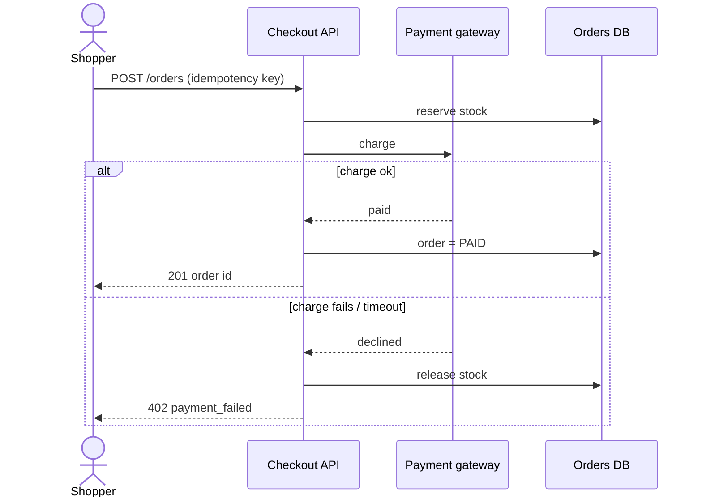

# Diagrams

Design + architect docs. Goal: reviewer grasps problem and solution from diagrams + captions alone, before reading prose.

| ID | Rule |
|---|---|
| DG1 | Pick by question (table below). One diagram answers one question. |
| DG2 | Required set per size (table below). Not applicable → one line: `Diagram: n/a — <why>`. |
| DG3 | Under every diagram: `**Read:**` + 2–4 plain-language bullets, in flow order. No jargon a non-author lacks. |
| DG4 | Mark change: `:::new` (added), `:::changed` (modified), `❌` on the failure point. Include the `classDef` lines. |
| DG5 | Mermaid, fenced. ≤ 12 nodes / ≤ 8 participants. More → split by use case or layer. |
| DG6 | Labels = domain words (`Checkout API`, `Order`), not class/file names. Arrows labelled with the call or data. |
| DG7 | Diagram ↔ text agree: every node appears in §Detailed design / §Data model, and vice versa. |

## DG1 — which diagram

| Question | Mermaid type | Typical section |
|---|---|---|
| Where does it break today? | `flowchart` (current state) | Problem |
| Who does what? | `flowchart` actors → system | Use cases |
| What parts exist, how connected? | `flowchart` component, subgraph per boundary | High-level design |
| Who calls whom, in what order? | `sequenceDiagram` | High-level design, per key UC |
| What changes vs today? | two `flowchart`s: before / after | Detailed design |
| How does data relate? | `erDiagram` | Data model |
| What states can X be in? | `stateDiagram-v2` | Detailed design |
| What types/interfaces exist? | `classDiagram` | Detailed design (new domain model only) |

## DG2 — required set

| Size | design stage | architect stage |
|---|---|---|
| Fix | none; flowchart if bug spans 2+ components | — |
| Change | current-state flow (Problem) | before/after flow |
| Build | current-state flow (Problem); actor flow if ≥ 3 actors | component; sequence per main UC (happy + 1 failure via `alt`); ER if data model changes; state if entity has lifecycle |

## Example

**Read:**
- Shopper places order; API reserves stock before charging, so no oversell.
- Charge succeeds → order marked paid, shopper gets order id.
- Charge fails/times out → stock released, shopper gets clear error; retry safe via idempotency key.
