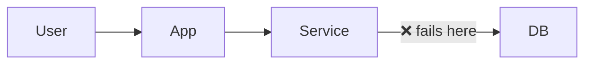
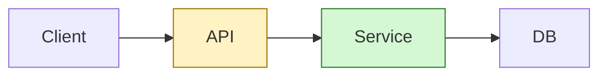
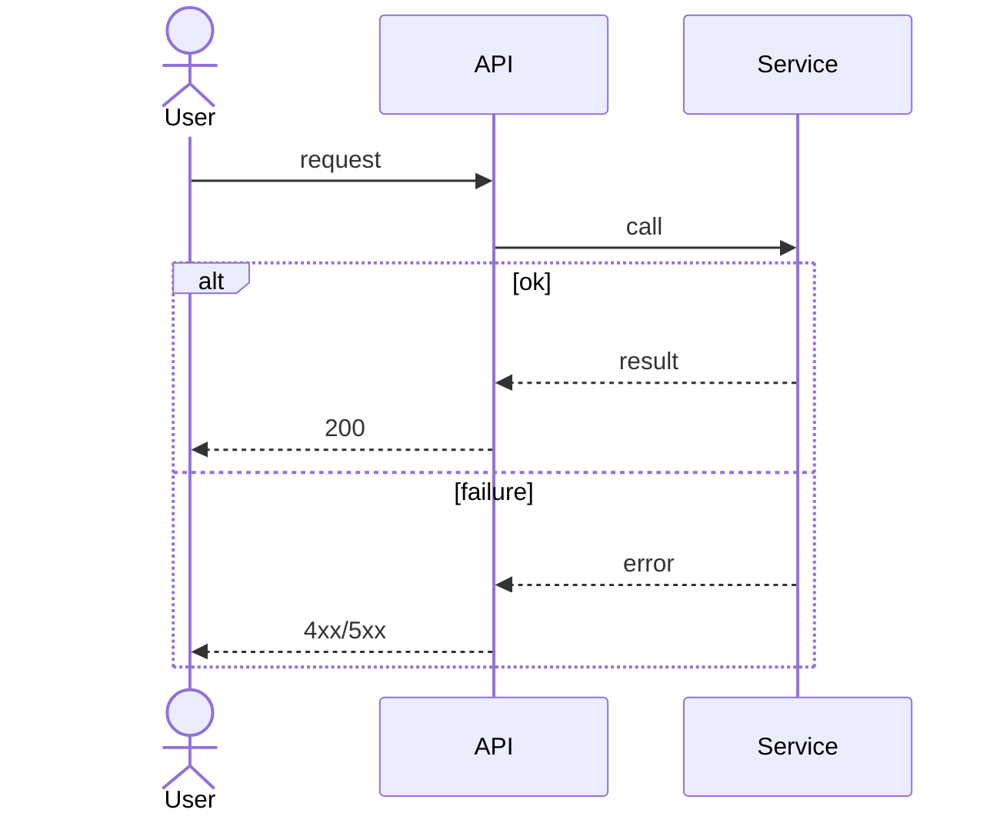
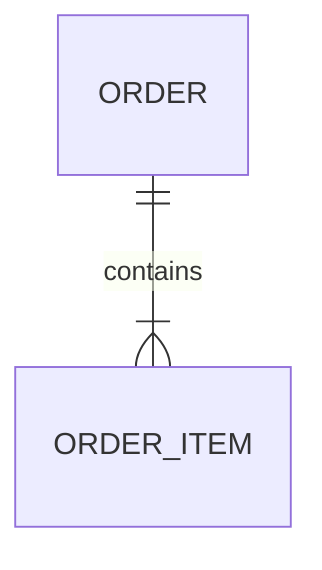

# <Title>

Status: <stage> · <⬜|🔄|✅|⛔> · YYYY-MM-DD
Size: <Fix|Change|Build> · Task: NN · Owner: <name>

<!-- Fix size keeps: Problem, Solving exactly, Detailed design (before/after), Test coverage. Omit the rest. -->
<!-- design stage owns Problem → Use cases. architect stage owns Approaches → Feature flags. -->

<!-- Diagrams: rules/diagrams.md. Every diagram gets a **Read:** caption (2–4 plain bullets). -->

## Problem
<!-- what's broken/missing · who hurts · evidence (ticket, log, metric, file:line) -->

**Read:**
- <today's flow in plain words, and where/why it breaks>

## Solving exactly
<!-- 1–3 bullets: precise outcome. Anything else is out of scope. -->

## Requirements
| ID | Type | Requirement |
|---|---|---|
| R1 | functional | |
| R2 | non-functional | <!-- latency, scale, availability, compliance --> |

## Scope
- In:
- Out:

## Use cases
| ID | Actor | Action | Result |
|---|---|---|---|
| UC1 | | | |

## Approaches
| | A: <name> | B: <name> |
|---|---|---|
| How | | |
| Pros | | |
| Cons | | |
| Effort / risk | | |

**Recommendation:** <A|B> — <one line why>.

## High-level design
### Components

**Read:**
- <what each part does; what's new vs changed>

### Sequence — UC1

**Read:**
- <step-by-step in plain words, incl. what user sees on failure>

- Components:
- Data flow:

## Detailed design
### <Component>
<!-- defect: before vs after. new impl: snippet. -->
```<lang>
// before — path/file.ext:42
```
```<lang>
// after
```

## Data model
<!-- tables/fields/indexes/migrations; omit if none -->

**Read:**
- <entities and how they relate>

## API design
<!-- one block per endpoint, every row of rules/api-standards.md API1 -->

## Security
<!-- relevant SEC# items from rules/security-checklist.md with answer -->

## Feature flags
| Flag | Default | Rollout | Kill switch | Removal |
|---|---|---|---|---|

## Test coverage
| Test | Level | Covers |
|---|---|---|
| | unit / integration / e2e | R1, UC1 |

## Open questions
-
